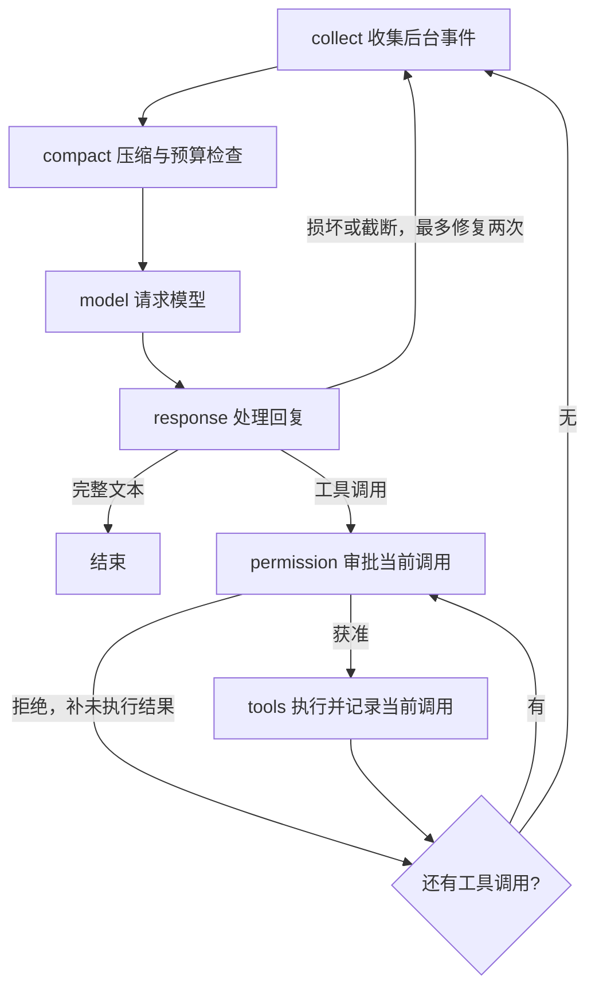

# mini-harness 机制说明

基于显式 LangGraph 状态图的 CLI coding agent，使用 LangChain 的模型适配和工具定义。
核心目标：代码易读、机制精简，功能集中在有明确职责的模块里。

## 核心循环

图的组织参考 [DeerFlow 1.x](https://github.com/bytedance/deer-flow/tree/main-1.x/src/graph)：
`builder.py` 连接流程、`nodes.py` 定义阶段、`types.py` 区分状态和运行资源。



每个节点只组织一个阶段，压缩、权限、进程机制仍在各自模块中。
工具按模型给出的顺序逐个审批、执行；后续调用按最新 cwd 检查，不做批内并行。
压缩在下一次主请求前发生，此时本批工具结果已经齐全。
回复截断或参数损坏时不执行该回复中的工具，补错误反馈让同一个模型重新生成；
有原始 JSON 参数时严格解析，避免流式适配器补全半截参数后误执行。
超过两次修复明确报错。摘要模型也检查截断标记，失败时保留原上下文。

## 运行

需要 Python 3.11+、Bash 和 POSIX 系统（目前在 Linux 验证）。在本项目目录安装：

```bash
uv sync
export OPENAI_API_KEY='你的 DeepSeek API 密钥'
uv run mini-harness
```

默认使用 `openai:deepseek-flash` 和 `https://api.deepseek.com`，无需传模型或接口参数。
模型名和地址对应 [DeepSeek 官方配置](https://api-docs.deepseek.com/quick_start/agent_integrations/)。
指定工作目录可加 `--cwd /path/to/project`。

其他兼容接口可显式覆盖模型和地址：

```bash
uv run mini-harness --model 'openai:YOUR_MODEL_ID' --base-url 'https://YOUR_ENDPOINT/v1'
```

使用 Anthropic 时按需安装适配器：

```bash
uv sync --extra anthropic
export ANTHROPIC_API_KEY='你的密钥'
uv run mini-harness --model 'anthropic:YOUR_MODEL_ID'
```

也可以设置 `HARNESS_MODEL`。密钥由供应商 SDK 读取，不保存到会话。
默认使用当前用户的本地权限，调用前执行下述权限策略；Linux/WSL2 可另行开启文件沙箱。

## 权限审批

所有模型工具调用先经过 `permission` 节点，获准后才进入执行记录和工具本身。

| 处理 | 默认规则 |
| --- | --- |
| 允许 | 项目和当前会话目录内的普通文件读写；受限参数的简单只读命令；停止本会话任务；更新计划 |
| 询问 | 目录外访问、修改 `env.sh` / `.git` 配置、删除文件、脚本、安装、联网、stdin 写入、未知工具或复杂 Shell |
| 拒绝 | 明确识别的 `rm -rf`、格式化/写磁盘设备、关机、破坏性 Git 操作、关键系统路径写入，以及改写会话数据库或原始记录 |

路径按真实路径检查，`cd` 不扩大允许范围。Bash 自动允许的命令是 `pwd`、`ls`、`cat`、
`head`、`tail`、`rg` 和部分只读 Git 操作，并且只接受实现中列出的选项。
`git diff/show` 自动允许时须在 `--` 前带 `--no-ext-diff --no-textconv`，禁用配置中的外部差异处理。
重定向、管道、命令替换、通配符、未知参数等不能确认安全的命令会询问。
这些规则用于调用级审批，不证明任意脚本安全，也不限制获准进程内部的所有行为。

交互时显示工具名、路径或完整命令及原因。输入 `y` / `yes` 仅同意本次调用；
输入 `a` 信任当前交互会话，后续所有“询问”类操作自动允许，包括目录外访问和脚本执行，
明确的“拒绝”规则仍然生效。信任只保存在内存，退出或重新启动、恢复会话后恢复默认审批。
其他输入和回车均拒绝。Ctrl-C 取消当前轮；EOF、`/exit` 或 `/quit` 退出，尚未获准的操作不会执行。
默认逐个询问，复用唯一输入线程。提示出现前收到的输入保留为聊天，不作为单次或会话授权。

`-p` 模式不等待审批：安全操作照常执行，需要询问的操作返回“未执行”的工具结果。
程序调用 `Harness.open(..., approve=callback)` 可以提供异步 `(tool_call, reason) -> bool` 回调；
省略回调时也不会自动放行需要审批的调用。审批前不记录 `started`，恢复会话时仍按原规则补齐工具结果。

添加 `--full-access` 跳过普通工具审批，包括原默认规则中的拒绝项，主、子智能体均生效；
权限与工具执行日志照常记录。已开启的沙箱仍然有效，沙箱扩权和临时绕过仍需明确批准。
此开关只对本次启动生效，恢复会话时需再次传入。程序调用可使用 `Harness.open(..., full_access=True)`。

```bash
# 单次任务
uv run mini-harness -p '查看项目并解释测试入口'
# 完全访问，无需审批
uv run mini-harness --full-access
# 查看和恢复会话
uv run mini-harness --list-sessions
uv run mini-harness --resume SESSION_ID
```

终端启动时显示会话 ID。恢复时沿用已保存的模型名、endpoint、上下文预算等设置，
显式传入的新参数优先。`--cwd` 默认当前目录；已有会话保留
自己的工作目录。日常自动化验证使用离线模型驱动真实 graph；另外已完成 DeepSeek
真实 API 的工具调用、会话恢复和手动压缩验证。

验证范围和结果见 [DeepSeek 实测记录](validation/2026-10-17-deepseek.md)。

`--max-steps` 限制一次运行的图节点步数，默认 100000；一轮模型与工具交互会经过多个节点。
旧会话保留原预算，需要时用 `--max-steps 100000` 覆盖。

## 文件沙箱

第一版支持 Linux / WSL2，默认关闭。先通过系统包管理器安装 Bubblewrap，例如 Ubuntu：

```bash
sudo apt install bubblewrap
uv run mini-harness --sandbox --full-access
```

`sandbox.py` 保存一份运行时策略，每次 Bash 通过 Bubblewrap 创建受限进程；LangGraph 连线不变。
宿主文件系统只读开放，初始项目目录、批准的额外目录和少量专用通道可写。
初始范围使用会话保存的 `project_root`，不会随 `cd` 或恢复时的启动目录扩大。
正常启动的子进程继承限制；网络与宿主共享，后台服务可由后续 Bash 调用访问。
文件工具在读写前检查同一份策略，文件锁和版本检查继续生效。

用户配置示例见 [sandbox.example.json](../examples/sandbox.example.json)，建议复制到项目外的用户配置目录：

```bash
uv run mini-harness --sandbox --sandbox-config ~/.config/mini-harness/sandbox.json
```

- `deny_paths`：明确的文件或目录路径，不支持 glob；支持 `~`，相对路径以配置文件目录为基准。
  添加现存路径；Bash 无法落实某条遮蔽规则时会报错，不静默忽略。
  同时禁止读取和写入，即使位于项目或已授权目录中；Skill、AGENTS.md 和压缩后的回读也遵守规则。
- `allow_write_requests`：默认 `true`。模型用 `request_sandbox_access(paths, reason)` 申请额外可写目录。
  批准后供主、子智能体的新调用使用，退出即清除，恢复会话重新申请。
- `allow_bypass`：默认 `false`。用户启用后，Bash 可通过 `bypass_sandbox=true` 和 `reason` 申请一次绕过。
  它会解除本次命令及子进程的文件沙箱限制，包括禁止路径，审批界面会明确显示。

扩权与绕过只接受明确批准，普通会话信任和 `--full-access` 不代替它；无交互审批时拒绝申请。
用户配置文件在沙箱内始终只读；批准额外父目录不会改变这一点。配置重读不清除旧上下文或历史产物中的内容。
审批与执行使用同一份规范化目录；批准前目录目标发生变化会拒绝执行。
禁止路径、配置和会话目录在可写范围内的祖先设为挂载点，阻止通过移动父目录暴露旧内容或替换策略。
启动时固定 Bubblewrap 的实际程序路径，并保护它不被工具修改或被项目中新建的同名程序接管。
`--no-sandbox` 可显式关闭，包括恢复一个原先启用沙箱的会话。配置和 Bubblewrap 不可用时会明确报错。

可写例外逐项保留：当前会话的 `env.sh`、真实的 `tmp/` 目录、日志与 cwd 回传通道。
文件工具和 Bash 共享 `tmp/`，默认 TMPDIR 指向这里；文件跨调用及会话恢复保留，删除会话时一起删除。
可先用 write_file 写测试脚本，再用后续 Bash 执行，无需把中间产物放进项目。宿主 `/tmp` 仍只读。
SQLite、transcript 和其他管理产物由外部 harness 写入，不开放整个会话目录给命令修改。
会话数据即使放在项目内也保持只读，仅为当前会话的专用通道单独开放。
禁止路径优先于这些工具访问例外。包管理器缓存可指向项目内，或申请其缓存目录的写权限。

MCP 服务端在本地 Bash 沙箱之外执行，保留现有权限模式；`--full-access` 下不额外询问 MCP。
本地沙箱不约束 MCP、宿主网络服务及 Windows 桌面端的实际操作，也不提供文件回滚或资源配额。
WSL 内默认隐藏 `/init` 和 `/run/WSL` 执行桥接入口，阻止命令直接启动不继承 Linux 限制的 Windows 程序。
确需执行 Windows 程序时，可由用户批准一次完整绕过；沙箱外的 Windows MCP 连接不受此影响。

## 工具与执行

基础工具：`bash`、`read_file`、`write_file`、`edit_file`、`read_image`。
搜索优先通过 Bash 的 `rg`，不可用时使用 `grep`/`find`。
`read_file` 使用从 1 开始的行号；`edit_file` 只接受唯一、非空的精确匹配。
read_file 默认最多 200 行、12000 字符（包含行号）；max_chars 可调至 100000。
按完整行分页，不二次裁成预览；start_line/end_line 是实际交付范围，有后续内容时用 next_offset 继续。
单行超出预算时明确提示提高 max_chars 或通过 Bash 分段查看；非 UTF-8 提示使用图片工具或检查编码。
编辑结果包含局部 unified diff；长结果继续保存到 artifacts 并返回短预览。

文件工具使用短时非阻塞锁：主智能体、子智能体和独立会话按目标绝对路径共享
`${XDG_STATE_HOME:-~/.local/state}/mini-harness/file-locks/`，不在项目创建锁元数据。
XDG_STATE_HOME 为空或不是绝对路径时使用默认用户状态目录，避免锁位置随启动目录变化。
冲突直接返回文件名和占用者 Session ID，异常也会释放锁。
升级后应关闭旧版本 harness 再重启；旧的项目锁文件不会自动迁移或删除，以免影响尚在运行的进程。
读取时记录完整文件的 SHA-256，保存在各会话 `runtime.sqlite` 的 `metadata.file_versions`。
压缩后的自动附件读取不确认新版本，修改前仍按显式读取的记录检查。
已有文件须先读取再修改，新文件可以直接创建；版本变化时拒绝覆盖，重新读取后再编辑。
这套保护覆盖内置文件工具；Bash、MCP 和外部编辑器不自动遵守锁。

进程控制提供 `wait_task(task_id, timeout, max_output_bytes)`、`send_input` 和 `stop_task`：

- 每次 Bash 都启动新进程，继承启动环境时过滤 `OPENAI_API_KEY`、`ANTHROPIC_API_KEY`、
  `DEEPSEEK_API_KEY`、`AZURE_OPENAI_API_KEY` 和 `AZURE_OPENAI_AD_TOKEN`；父进程的模型配置不受影响。
  每个会话自动创建一份空的 `env.sh`，
  每条命令执行前在同一 Bash 中 `source`。固定系统提示包含文件的绝对路径和加载规则；
  智能体可通过文件工具读写它，修改在下一次 Bash 调用生效。
  文件跨工作目录使用，恢复会话时保留原内容；一次命令里的临时 `export` 不跨调用。
  项目有意写入 `env.sh` 的变量仍会加载。
- 前台命令完成后保存真实 cwd；同一会话 Bash 调用串行。后台任务不会回写 cwd。
- `timeout` 是前台等待时间，默认 120 秒；未完成时保留原进程并转后台。
  `run_in_background=True` 则直接后台运行。
- stdout/stderr 持续写入文件，结果返回日志路径、头尾预览、任务 ID 和退出码。
  max_output_bytes 默认 2000，可调范围 1..100000；超长时保留约四分之一开头和四分之三尾部，
  并标明 `truncated` 和 `output_bytes`，完整输出始终在日志文件。
  stdin 使用普通管道，可追加输入和发送 EOF；没有 PTY。
- 后台完成通知在安全的模型调用点注入；空闲的交互 CLI 可以继续处理完成事件。
- wait_task 默认等待最多 30 秒，timeout=0 立即查询，允许范围 0..120 秒。
  超时或取消只结束等待，后台任务与 watcher 继续运行；恢复后的旧任务返回已记录状态，不使用旧 PID。
  恢复任务也按本次输出上限读取原日志；日志已删除时返回有界缓存并标明 output_missing。
- `--process-timeout` 控制命令最长运行时间，默认一小时。停止和正常退出会清理进程组。
  shell 结束后也会清理遗留子进程；长服务使用 `run_in_background=True`。
- 恢复后将原来的活动进程记录标为 interrupted，不会使用旧 PID。

系统提示在会话组装时固定，包含核心规则、项目根目录和环境文件路径。
当前工作目录和根目录 `AGENTS.md` 会在调用模型前检查，首次或内容变化时追加运行上下文
消息；不改写之前的消息，保留普通工具循环中的请求前缀。压缩后会补齐最新运行上下文。

## 任务计划

模型用一个普通工具 `update_plan(plan, explanation=None)` 维护当前任务的步骤清单。
多步骤任务按需使用，简单任务跳过；工具只记录计划，不调度或执行步骤。
每次提交完整列表，替换该 session 的当前清单；传入 `[]` 清空：

```json
{
  "plan": [
    {"step": "阅读相关代码", "status": "completed"},
    {"step": "实现修改", "status": "in_progress"},
    {"step": "运行测试", "status": "pending"}
  ],
  "explanation": "根据代码结构补充测试步骤"
}
```

步骤文字不能为空，状态只有 `pending`、`in_progress`、`completed`，最多一步进行中。
错误参数返回工具错误，保留原计划。更新计划直接允许，不额外询问执行权限。

最新清单和可选说明保存在当前会话的 `runtime.sqlite`，使用 metadata 的 `plan` 键；
每次更新向 `transcript.jsonl` 追加 `plan` 记录。不同 session 的清单相互独立。
运行上下文消息带上最新计划，只在内容变化或上下文缺失时追加，不改写系统提示和旧消息。
Micro 不裁剪运行上下文；摘要后重建最新计划，Reactive 保留最新运行上下文，恢复会话时同样读取。
CLI 复用 `tool_end` 事件显示 `[ ]` / `[>]` / `[x]` 和完成数量，不增加图节点或事件类型。

## 子智能体

主模型通过四个普通工具委派工作，不增加图节点：

| 工具 | 用途 |
| --- | --- |
| `spawn_agent(task, timeout=600)` | 新建独立子 Session，立即返回 `agent_id` |
| `wait_agent(agent_id)` | 等待当前轮结束，或读取已经保存的结果 |
| `continue_agent(agent_id, message, timeout=None)` | 在原对话中继续；重新计时，缺省沿用原时限 |
| `close_agent(agent_id)` | 停止运行并关闭子智能体，保留记录 |

子智能体与主智能体在同一 Python 进程中，通过 `asyncio.Task` 并行等待模型和工具。
模型配置和执行代码复用；对话、检查点、cwd、`env.sh`、进程管理器和文件锁各自独立。
项目文件共享；初始 cwd 使用父会话当前目录，权限范围仍继承父会话固定的项目根目录。
子系统提示包含自己的 ID、父 Session ID 和父会话目录；不自动复制父对话全文。
委派时由主模型提供任务及必要背景。子智能体不提供 `update_plan` 和四个子智能体管理工具。

子会话保存在 `<父会话目录>/subagents/<agent_id>/`，与普通 Session 使用相同文件结构。
父会话 `runtime.sqlite` 的 `subagents` 元数据保存 ID、状态、本轮输入和结果；
子会话保存 `parent_session_id` / `parent_session_dir`。结果过长时保存原文，只向父模型返回预览和路径。
运行上下文列出尚未关闭的子智能体，压缩或重启后仍可通过 `wait_agent` 找回结果。

一轮完成进入 `waiting`，最终结果通过原有后台队列交给父模型；中间输出留在子会话。
父模型判断任务是否完成，再关闭或追加指令。每轮结束都会释放会话连接、文件锁和进程资源；
等待后续指令期间只保留记录。子会话启动的服务也随该轮结束清理，需要持续运行的服务由主会话管理。

`timeout` 单位为秒，必须有限且大于零，包含模型、工具及等待审批的时间。
超时清理当前轮进程并返回 `timed_out`；异常返回 `failed`，都可由父模型明确继续。
继续使用原 Session 和已有上下文，重新开始计时。`closed` 状态不再接受继续指令。
超时或取消落在清理阶段时，会等待所有进程结束后再关闭会话、报告最终状态。
默认审批按子会话 cwd 使用相同规则，询问交给主 CLI 并标明来源；会话信任也共用，拒绝规则仍生效。
父智能体启用 `--full-access` 时，子智能体同样跳过普通审批；共享的沙箱规则及明确扩权审批仍然有效。

Ctrl-C 取消父轮次时会中断运行中的子智能体；退出 CLI 同样等待它们清理并保存 `interrupted`。
恢复父对话的下一轮会自动在原子 Session 中继续，补齐缺失工具结果，不直接重放中断命令。
检查点单独保存已接收的输入 ID，原任务被摘要压缩后也不会重新追加为新指令。
`waiting`、`timed_out`、`failed` 和 `closed` 不自动续跑。`/tasks` 同时列出进程和子智能体状态。
单次 `-p` 模式在主轮结束后退出，主模型需要先用 `wait_agent` 取得所需结果。

## MCP

安装可选的客户端依赖：

```bash
uv sync --extra mcp
uv run --extra mcp mini-harness --mcp-config path/to/mcp.json
```

通过 `--mcp-config` 显式启用；未指定时不连接，也不注册 MCP 工具。
配置路径会随会话保存，`--resume` 时重新连接。配置在启动时读取，`cd` 不切换服务器。
配置中的 `command` 会在打开会话时启动；`args` 按参数列表传入，`env` 显式配置服务器环境。
stdio 的 `cwd` 缺省为配置文件所在目录，相对 `cwd` 也以该目录解析；`env.sh` 只用于 Bash。
请求与初始化超时均为 60 秒，连接或配置错误直接报告，不自动更换服务器或重试工具动作。

模型只获得两个通用工具，外部工具目录按需读取：

| 工具 | 用途 |
| --- | --- |
| `list_mcp_tools()` | 列出已配置的服务器名称 |
| `list_mcp_tools(server, tool_name=None)` | 查看工具描述和参数 schema，可按工具名筛选 |
| `call_mcp_tool(server, tool_name, arguments)` | 调用选中的工具 |

发现工具直接允许；实际调用沿用现有审批，`--full-access` 下直接允许。
文本与结构化结果进入工具消息，超长结果复用 `artifacts/` 落盘。
图片和音频保存为文件并返回路径，当前不作为多模态内容发给模型。

支持 stdio 与 Streamable HTTP。例如连接已经启动的 HTTP MCP 服务：

```json
{
  "mcpServers": {
    "example": {
      "url": "http://127.0.0.1:8000/mcp"
    }
  }
}
```

HTTP 可在同一配置项中添加 `headers`，例如服务要求的 Authorization 头。
`.mcp.json` 默认被 Git 忽略，实际密钥留在本地配置中。

[Windows-MCP](https://github.com/CursorTouch/Windows-MCP) 必须运行在 Windows 侧。
当前版本需要 Python 3.14+，可在 Windows PowerShell 中用 `uvx --python 3.14 windows-mcp --help`
先准备环境；通过 `Get-Command uvx` 确认可执行文件路径，再修改
[`examples/mcp.windows-wsl.json`](../examples/mcp.windows-wsl.json) 并作为 `--mcp-config` 传入。
这个示例通过 Windows PowerShell 启动服务器，harness 继续运行在 WSL 中。
启动配置定向忽略 MCP 日志接口的弃用警告，其他警告和错误照常输出。
普通文本模型先使用 `Snapshot` 的文本 UI 树；截图返回图片文件，需要视觉能力时另行接入。

主会话保持 MCP 连接，子智能体复用父连接；结束子智能体不会关闭共享服务器。
退出主会话时关闭所有客户端，并结束由本会话启动的 stdio 服务；HTTP 服务由外部管理。
恢复会话会建立新连接，服务器内存状态和临时句柄不保证延续，应重新读取远端状态。

## Skills

模型通过两个普通工具按需发现和加载 skill，系统提示只说明工具用法，不包含技能目录：

- `list_skills()`：读取项目技能的 `name` 和 `description`，不返回正文。
- `load_skill(name)`：返回选中技能的完整正文、名称和 `directory` 绝对路径。

第一版只支持初始项目目录下的 `.agents/skills/`：

```text
.agents/skills/
└── python-testing/
    ├── SKILL.md
    ├── references/testing.md
    └── scripts/check.py
```

`SKILL.md` 的最小示例：

```markdown
---
name: python-testing
description: 为本项目编写或调整 Python 测试时使用。
---
先阅读 references/testing.md，再编写测试。
使用 uv run pytest -q 执行测试。
```

名称须与文件夹一致，使用小写字母、数字和连字符；描述支持 YAML 多行文本。
模型从 `list_skills` 的描述中选择技能，调用 `load_skill` 后，再按正文要求使用
`read_file` 读取参考资料、使用 Bash 执行脚本。相对资源路径以返回的技能目录为基准。
加载技能只读取文件，后续操作沿用现有权限规则；skill 中的字段不会扩大执行权限。

两个工具在调用时重新读取文件，所以新增或修改技能在下次调用时生效，`cd` 不改变扫描目录。
只读取项目技能目录中的文件，越界路径和指向目录外的符号链接被拒绝；格式错误作为工具错误返回。
成功加载的指令所在完整工具组受 Micro、摘要和 Reactive 压缩保护，并随会话检查点恢复；
技能列表作为普通工具结果参与压缩。

## 上下文压缩

设计基线是讨论中选定的[压缩机制文章](https://deepseek.csdn.net/6a2233c610ee7a33f277cf93.html)。
机制如下：

1. read_file 返回有界完整行分页；其他大型文字结果落盘返回预览，Bash 输出直接写日志文件。
2. Micro：倒序扫描工具结果，保护近期完整工具往返与输出预算；旧结果攒够可节省量后，
   才批量替换为稳定的文件引用。请求间隔达到 5 分钟时降低裁剪门槛，保护范围不变。
3. Auto：超过自动阈值时，生成九项结构化摘要，并保留近期完整轮次。
4. Blocking：仍超过预算时停止发送普通模型请求。
5. Reactive：收到明确的上下文超限错误后，按完整消息组裁掉最旧历史，不调用摘要模型，
   用缩短后的上下文重试主请求一次。

模型窗口通过 `--context-window` 指定，默认保守使用 128000。
输出预留通过 `--output-reserve` 指定，默认 8192。自动阈值为窗口减输出预留再减
13000 安全余量；阻塞阈值使用 3000 余量。首次请求按 UTF-8 大小粗估，包含工具定义和系统提示。
收到 API 的 `input_tokens` 后，后续未变的历史前缀使用实际用量，新增内容仍按本地增量估算。
Micro 或摘要改写历史后退回粗估；恢复会话的首次请求或 API 未返回 usage 时也使用粗估。
这不是精确 tokenizer，请按实际模型配置窗口；CLI 为支持该选项的适配器开启流式 usage。

Micro 参考 [OpenCode v1.2.0 的预算式裁剪](https://github.com/anomalyco/opencode/blob/v1.2.0/packages/opencode/src/session/compaction.ts)，
按完整模型/工具往返保护近期内容，不按用户发言次数计数，所以单个长任务也能清理旧输出。
默认保护最近两组往返，同时保护近期约 40000 tokens 的工具输出；两个条件包含同一批
内容，不额外累加。边界处保留整个并行工具结果组，保护量可以略超预算。
旧结果的净节省量合计超过 20000 tokens 时才裁剪；不足门槛时不改消息，也不创建文件。
已裁剪结果保持原引用，原始消息与工具调用 ID 保留；短结果不会换成更长的文件指针。

距上次主 agent 模型请求开始达到 300 秒时，旧结果只要存在正的净节省量就可裁剪。
这个间隔是本地策略，不代表供应商缓存一定失效。时间保存到会话元数据，恢复时沿用；
摘要请求不刷新它，时间戳也不进入提示词。每次主 agent 请求前检查，无需定时任务。

| 参数 | 默认值 | 含义 |
| --- | ---: | --- |
| `--micro-keep-rounds` | 2 | 至少保护的近期完整工具往返组数 |
| `--micro-keep-tokens` | 40000 | 近期工具输出保护预算 |
| `--micro-min-savings` | 20000 | 正常模式批量裁剪的净节省门槛 |
| `--micro-idle-seconds` | 300 | 切换到强化裁剪的主模型请求间隔 |

这些参数随会话保存；恢复时可用同名 CLI 参数覆盖。
单次大输出仍在工具返回前处理：read_file 按完整行分页，其他长文字结果落盘预览，Bash 直接写日志，
`ContextManager` 负责历史清理，避免巨型结果先进入模型上下文。

摘要压缩后会按预算重新读取最近通过文件工具查看的文件范围；项目指令每次请求重新加载。
自动重读只覆盖可直接允许的文件；目录外文件须通过新的工具调用再次审批。
原始历史不删除，摘要含有原始 transcript 路径。工具调用与对应结果始终整组保留。
连续三次自动压缩失败后停止自动尝试；手动压缩成功会重置计数。
每次摘要只发一次请求，不反复拆批或递归合并。输入超出本地预算、供应商拒绝、摘要为空或截断时，
保留原上下文并报告失败。Auto 与手动摘要不会静默删除未经总结的旧需求。

Reactive 是 API 已报告输入过长时的异常兜底，采用规则裁剪而不是再次生成摘要。
它从最老的完整消息组开始删除，以请求估算量减半为目标，保留最新用户请求、已有摘要、
最新运行上下文，以及最近 assistant 所属用户轮次的最后工具组、后续回复和用户输入或内部通知。
保护内容本身过大时可能达不到减半目标，但只有请求确实变小且低于本地阻塞阈值才重试。
模型会收到明确的历史省略提示和原始 transcript 路径；旧原文没有从磁盘删除。
成功后把较短上下文写回 checkpoint；重试失败则保留原状态，不再自动重试。
只剩受保护内容而无法进一步缩短时，明确报错，不发送同样大小的请求。
这套裁剪边界和减半目标是本项目的具体选择；参考文章所述 Reactive 外部构建是 stub，
没有给出可以直接复用的完整实现。

```text
/compact                         手动压缩
/compact focus on migration      带补充要求的压缩
/compact --from 1 --to 4          仅压缩指定完整轮次，保留两侧消息
/tasks                           查看进程和子智能体状态
/stats                           查看主会话累计 token 与缓存命中率
/sessions                        查看会话 ID
/help
/exit
```

部分压缩范围从 0 开始，左闭右开；每个 assistant 消息及其全部工具结果属于同一轮。
`--no-auto-compact` 可关闭自动摘要，保留手动压缩和请求预算检查。

Micro 是可移植的本地实现，不依赖 Anthropic 内部 cache_edits；裁剪会改变请求前缀，
批量门槛用于减少频繁改写。
模型摘要调用是独立调用，目前不复刻 CC 的缓存共享 fork 优化。

## 会话与恢复

```text
~/.mini-harness/sessions/<session_id>/
├── state.sqlite        # LangGraph checkpoints
├── runtime.sqlite      # 运行元数据和工具执行记录
├── transcript.jsonl    # 原始消息和执行/压缩事件，追加写入
├── env.sh              # 唯一的会话环境脚本，自动创建，智能体可修改
├── tmp/                # 文件工具与 Bash 共享的中间文件，跨调用及会话恢复保留
└── artifacts/          # 完整工具输出、进程日志、cwd 回传文件
```

会话目录可通过 `--session-dir` 更改。同一会话只允许一个写入者。
运行元数据与异步 checkpoint 分库，避免后台完成通知与 checkpoint 争锁。
恢复加载当前有效上下文，直接复用已保存摘要。
工具执行节点登记开始、调用一次工具、保存结果；历史调用由恢复入口处理。
恢复入口读取包含待合并记录的完整快照，按调用 ID 补齐工具结果，并放回对应调用之后、后续用户消息之前。
完整历史写回图，避免新输入丢掉尚未合入检查点的结果；异常和中断统一记为 `error`。
结果未确认的中断调用不会自动重跑，而是让模型先检查文件或日志。
恢复上下文也不会回滚已经修改的项目文件。

交互时 Ctrl-C 取消当前轮次。前台 Bash 等进程组清理完成后，保存退出状态和日志路径；
普通后台进程保留，取消 wait_task 只停止等待。短文件写入没有 await，完成后才处理取消；
MCP 请求取消不能保证撤销远端操作，结果未确认时要求模型先检查，不自动重试。
父轮次取消也会清理运行中的子智能体，并保留原子会话以便恢复。

中断出口立即补齐本批工具结果、清空待执行调用并保存检查点；已经完成的修改不回滚，
尚未开始的工具不执行。连续 Ctrl-C 不会打断当前清理。被打断的半截模型回复不执行工具。
清理完成后回到输入状态，后台完成通知暂存，直到显式聊天输入（含已排队聊天）才交给模型；
/tasks、/stats 等命令不解除暂停。正常未打断时，后台完成通知仍可自动触发下一轮。
空闲时 Ctrl-C 暂停自动通知。Ctrl-D 或 `/exit` 退出并清理进程和子智能体运行资源。

## 阅读代码

代码按职责归类；提示词包提供 `load_prompt()`，其余包的 `__init__.py` 只说明用途。

```text
src/mini_harness/
├── agent.py             # 会话入口：组装资源、恢复结果、流接口
├── subagents.py         # 子会话委派、继续、超时、关闭与恢复
├── sandbox.py           # 共享路径规则、临时授权与 Bubblewrap 参数
├── graph/
│   ├── builder.py       # 六阶段连线与退出条件
│   ├── nodes.py         # 每个阶段做什么
│   └── types.py         # 持久化状态与运行资源
├── context/
│   ├── manager.py       # 请求前准备、手动压缩、超限恢复
│   ├── compact.py       # Micro、摘要、Blocking、Reactive
│   └── policy.py        # 窗口、阈值与保留范围的默认配置
├── tools/
│   ├── factory.py       # 显式列出模型可调用的工具
│   ├── agents.py        # 父智能体的四个委派工具
│   ├── files.py         # 文件读取、写入、精确替换
│   ├── file_guard.py    # 文件锁与各会话的内容版本检查
│   ├── plan.py          # 单会话当前计划的校验、整表更新与保存
│   ├── skills.py        # 按需列出项目技能、加载指令与资源路径
│   ├── mcp.py           # MCP 连接生命周期、按需发现与通用调用
│   ├── processes.py     # Bash、cwd、stdin、后台任务与清理
│   └── permissions.py   # allow / ask / deny 与单次审批
├── cli/
│   ├── main.py          # 创建模型、打开会话、选择运行方式
│   ├── config.py        # 参数解析与配置恢复
│   ├── interactive.py   # 输入、审批、会话命令与 Ctrl-C
│   ├── display.py       # 正文与执行状态展示
│   └── usage.py         # 单次缓存用量与主会话累计统计
├── session.py           # 会话锁、SQLite、JSONL、输出文件
├── responses.py         # 模型请求、流式回复合并与校验
└── prompts/
    ├── __init__.py      # 简短的提示词读取函数
    ├── system.md        # 共同的编码与工具规则
    ├── main.md          # 主智能体的计划与委派指令
    ├── subagent.md      # 子智能体的职责与返回要求
    └── summary.md       # 压缩摘要提示词
```

建议先读 `graph/builder.py` 看完整循环，再读 `graph/nodes.py` 看每个阶段。
随后读 `context/manager.py` 的 `prepare_messages()`，理解 Micro → Auto → Blocking 的调用顺序，
以及 `request_model()` 的一次 Reactive 重试。各层的算法集中在 `context/compact.py`，
Auto 与 `/compact` 复用同一个 `summarize()`；关键函数附有简短中文说明。
配置默认值集中在 `context/policy.py`，CLI 复用它们。

命名直接表达用途：`user_input` 是输入文本，`input_task` 是等待输入的异步任务，
`output_path` 是日志路径。参数的单位、索引范围和返回值在关键函数的 docstring 中说明。

后续增加工具，在 `tools/` 放具体实现，并在 `factory.py` 的明确列表中接入；
增加压缩策略，在 `context/compact.py` 实现，由 `manager.py` 调度；
增加执行阶段，在 `graph/nodes.py` 定义，再到 `builder.py` 连线。
只有同一类文件确实增多时再细分目录，不提前建立插件或注册框架。
新增提示词直接放进 `prompts/`，通过 `load_prompt("文件名，不含扩展名")` 读取。

CLI 将模型正文输出到 stdout，模型请求、工具开始/结果、后台完成、压缩和修复状态输出到 stderr。
预览只展示少量行，完整结果按提示查文件或继续读取。`Harness.events(user_input)` 提供这些事件；
`Harness.stream(user_input)` 保留只产生模型正文的接口。旧 `create_agent` 会话的消息检查点可以继续恢复。
`model_end` 事件包含耗时、API usage 和结束原因，也写入会话记录；CLI 显示这些信息。
每次请求显示缓存命中率，例如 `cache 80.0% (560/700)`，表示输入的 700 个 token 中有 560 个命中缓存。
`/stats` 从当前会话的 `transcript.jsonl` 汇总已记录的主请求，恢复会话后继续累计；
不含独立子智能体和摘要调用，也不会发起模型请求或改变上下文。
累计命中率为缓存 token 总数除以对应输入 token 总数，不平均每次的百分比。
API 未返回缓存数据的请求不参与该比率，界面会显示数据覆盖的请求数；无数据或输入为 0 时显示 `n/a`。
工具事件带调用 ID，结束事件带退出码；Bash 非零退出会记录为 error。
请求失败时 CLI 显示异常及其底层原因，便于定位代理、DNS 或连接问题。

任务依赖与认领、长期记忆和 hooks 的具体方案继续逐模块讨论，
当前没有为它们增加占位实现或通用插件框架。

## 图片

`tools/images.py` 的 `read_image(path)` 支持 PNG/JPEG，按文件头识别，最多读取 5 MiB。
沿用文件权限、沙箱检查和文件锁；原始字节按哈希保存到会话 `artifacts/`。
工具返回保存路径和 LangChain 标准图片块，不增加依赖或图节点。
主请求由 `responses.model_messages()` 把图片放到整组工具结果之后的用户消息，
保存的工具结果保持完整，恢复会话复用原图快照。需要支持图片输入的模型/API，默认模型不变。
MCP 截图仍先落盘，模型按需使用 `read_image` 查看。

Micro 沿用近期保护与批量阈值，旧图片整块移除并保留文字路径，替换文本固定复用。
文字摘要不包含图片编码，只保留原图路径和模型之前的观察；不额外生成图片描述。
图片暂按每张 4096 token 粗估，再用 API usage 校准；这是启发值，不是精确用量上界。
初版不缩放图片、不做 OCR，也不提供 CLI 图片附件语法。

## 验证

GitHub Actions 的 [CI 工作流](../.github/workflows/ci.yml) 在推送和 PR 时自动运行，
也可以从 Actions 页面手动触发。使用 Ubuntu 和 Python 3.11，按 `uv.lock` 安装全部
可选适配器及开发依赖，执行 Ruff、完整离线测试和 CLI 帮助命令，无需配置模型 API 密钥。

```bash
uv sync --locked --all-extras --dev
uv run pytest -q
uv run ruff check .
uv run mini-harness --help
```

测试使用真实临时文件、Bash 进程、SQLite 和 LangGraph，只替换外部模型调用。
另有本地 HTTP/SSE 测试，通过真实 OpenAI 适配器验证 CLI 工具调用、流输出和会话恢复。
真实 API 已验证上述 DeepSeek 配置；其他供应商仍需分别验证。

详细设计与实施记录见 [spec](superpowers/specs/2026-10-17-harness.md)
和 [plan](superpowers/plans/2026-10-17-bootstrap.md)。
